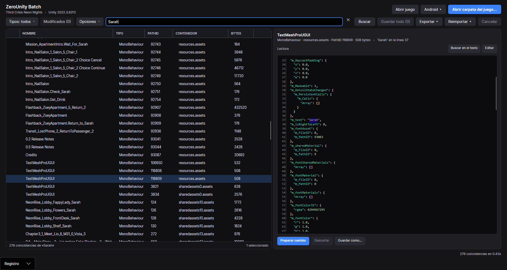

# ZeroUnity Batch

[](https://github.com/AtaraxyInDev/ZeroUnityBatch/actions/workflows/build.yml)

**A batch asset re-importer for Unity games, built for game localization.** Open a game folder,
queue thousands of translated JSON/PNG files, and write them back in one pass — with verification.

It is a rework of [UABEA](https://github.com/nesrak1/UABEA) Next 4's workflow: same engine
([AssetsTools.NET](https://github.com/nesrak1/AssetsTools.NET)), same JSON format, but designed
around *throughput* instead of browsing one object at a time.

```text
 UABEA Next 4            ZeroUnity Batch
 ─────────────           ────────────────
 open object             open game folder (or APK)
 import JSON             queue 4,700 JSON at once
 save                    one grouped write per container + verify + .zub_bak
 repeat 4,700 times      ~28 seconds
```



---

## What it handles

| Asset type | Read | Export JSON | Batch import |
|---|---|---|---|
| **MonoBehaviour** (PlayMaker FSM, dialogue, UI text, quests) | ✅ | ✅ UABEA-compatible | ✅ |
| **TextAsset** (JSON/CSV/TXT inside the game) | ✅ | ✅ | ✅ |
| **Texture2D** (UI, logos, buttons) | ✅ PNG preview | ✅ PNG export | ✅ PNG/JPG → re-encode |
| **AssetBundle** (Addressables `aa/<platform>/*.bundle`) | ✅ | ✅ | ✅ with recompression |
| **Android splits** (`.split0`, `.split1`, …) | ✅ merged | ✅ | ✅ re-split on save |

Containers are discovered automatically: `globalgamemanagers`, `resources.assets`,
`sharedassets*.assets`, `level*`, plus Android `assets/bin/Data` and its split parts.

## Why it is fast

* **Nothing is written until you say so.** Imports go into a queue; the *MOD.* column marks every
  pending object. *Save all (N)* groups edits by container and writes each file **once**.
* **Verified writes.** Every container is written to `.zub_new`, re-read, compared against the
  expected bytes, and only then replaced — the original stays as `.zub_bak`.
* **Virtualized editor.** A 700 KB MonoBehaviour opens instantly (AvaloniaEdit + TextMate), where a
  plain `TextBox` would freeze.
* **One index, not one file at a time.** A full game (555,549 objects / 41 containers) is indexed
  in seconds and stays in memory.

* **Parallel export.** Names, templates and the object bytes are read in one serial pass (an
  `AssetsFileReader` is not re-entrant); deserialising and writing the JSON then runs on every core,
  each thread with its own reader over a zeroed copy of the object.
* **No `JToken` tree on export.** A purpose-built writer emits the same bytes UABEA does
  (2-space indent, CRLF, `1.0`, `"Infinity"`) without building an object graph per asset.

Measured on *Third Crisis Neon Nights* (Unity 2022.3, 555k objects):
4,739 MonoBehaviour JSON re-imported and saved in **~28 s**; a 92 MB Addressables bundle
re-imported and recompressed in **30–50 s**.

Measured on *ZH-GALxSurvival* (Unity 6, `data.unity3d` + 44 Addressables bundles, 81k objects),
17,919 MonoBehaviours:

| Operation | Before | Now |
|---|---|---|
| Export all MonoBehaviour JSON | 126 s | **43 s** |
| Import (dry-run, 17,250 objects) | ~170 s | **66 s** |

Export output is byte-for-byte reproducible between runs.

## Features for translation work

* **CSV injector.** Feed it a translation sheet with the columns
  `archivo,campo,indice,texto_original,traduccion`, and it resolves each row to
  `container + PathID`, writes the field by path (`Lines.Array.Text`, `m_text`, `Description`…) and
  falls back to replacing `texto_original` inside the object when the path does not match.
* **Search inside the game.** Search by name, PathID, container — or inside the *content*
  (`Continue`, `"m_text": "Continue"`, `"m_text":` to list every object with that field). Results
  jump to the matching line, and pending edits are searched too.
* **Real field names on IL2CPP builds.** Point it at `DummyDll` (Il2CppDumper) or a `Managed`
  folder and MonoBehaviours expose their actual fields instead of `m_Name`/m_Enabled` only.
* **Class database 5.6 → 6000.** The right `classdata.tpk` entry is chosen automatically from the
  game's exact `UnityVersion` (exact → same family → nearest).
* **Cross-build JSON matcher.** JSON dumps from a PC build can be reused on the Android build: each
  file is validated by re-serializing the object before it is accepted (exact PathID → GameObject
  name → unique PathID), because PathIDs are not stable across builds.
* **Android pipeline built in.** Unpack with apktool → dump DLLs with Il2CppDumper → edit → repack →
  zipalign → apksigner. The whole toolchain (trimmed JRE, apktool, zipalign, apksigner,
  Il2CppDumper, debug keystore) travels next to the executable, so nothing has to be installed.

## Workflow

1. Drag the game folder (or its `.exe`, or a decompiled APK folder) onto the window.
2. Pick the asset types you care about.
3. **Reimportar → Cargar cambios de una carpeta** with your translated JSON/PNG files. Nothing is written yet.
4. Filter by **Modificados (N)** / the `●` marks and review in the editor.
5. **Guardar todo (N)** — one write per container, verified, `.zub_bak` kept.
6. **Abrir juego** to test.

## CLI (`zub`)

The same engine without the GUI, for scripting a pipeline:

```text
zub scan      [game]                 containers and object counts
zub dump      --name <fragment> -n N JSON of one object
zub roundtrip [game]                 read + rewrite the same object (sanity check)
zub find      --name <fragment>      list matching objects
zub export    --out <dir>            dump everything of a type to JSON/PNG
zub import    --from <dir> [--dry-run]
zub csv       --from <file.csv> [--dry-run]     translation sheet injection
zub tex / texinfo / settex           Texture2D export, header info, single re-import
zub gonames   --find <text>          which GameObject holds this text
zub match     --from <dir>           cross-build matching report
zub compare   <dirUABEA> <dirZub> [--exact] [--out informe.csv]
                                     parity check against a UABEA export (exit 3 if they differ)
zub android / dlls / apk             Android helpers
```

## How parity with UABEA is achieved

Wherever UABEA Next does something non-trivial we call **the same API**, instead of re-implementing
the format by hand:

| Task | Call used (identical to UABEA Next 4) |
|---|---|
| Read a texture | `TextureFile.ReadTextureFile(field)` + `TextureFile.GetTextureData(inst)` |
| Type names | `AssetsManager.ClassDatabase.FindAssetClassByID(id)` + `GetString(name)` |
| Read an asset | `AssetTypeTemplateField.MakeValue(reader, pos, RefTypeManager)` |
| JSON format | same field names/indent/CRLF as UABEA's exporter |

That is also how two classes of bug disappeared: legacy files report **negative type ids** for
MonoBehaviours (a Unity 5.3 game listed 0 of them until the ids were normalised) and `ARGB32` must be
read as **A,R,G,B** (reading it as B,G,R,A turned 482 of 1,731 textures yellow).

## Parity against UABEA

The GUI has a **Compare with UABEA…** button: pick the folder UABEA exported and the folder we
exported, and it reports how many files are identical byte for byte, how many are missing (and how
many of those are the same object under a different name) and how many differ, leaving a
`comparacion_con_zub.csv` with the detail. The same check is available as `zub compare`.

Real example (ZH-GALxSurvival, 17,920 MonoBehaviours): **17,583 identical**, 24 under another name,
1 unmatched, 312 different — but **311 of those 312 are objects UABEA itself could not read**
(it writes `Asset failed to deserialize.`), and in 189 of them we do produce the full JSON.

## Build

.NET 8 SDK, Windows x64 (Avalonia 11 + SkiaSharp).

```bash
dotnet build src/Zub.App/Zub.App.csproj -c Release          # GUI
dotnet run  --project src/Zub.Cli -c Release -- scan "C:\game"
```

Portable build (what `dist/` is):

```bash
dotnet publish src/Zub.App/Zub.App.csproj -c Release -r win-x64 \
  --self-contained false -p:PublishSingleFile=true -o dist
```

Windows installer (Inno Setup 6, per-user, no UAC): see `installer/ZeroUnityBatch.iss`.
It packages a **self-contained** publish so end users do not need .NET:

```bash
dotnet publish src/Zub.App/Zub.App.csproj -c Release -r win-x64 --self-contained true \
  -p:PublishSingleFile=true -p:IncludeNativeLibrariesForSelfExtract=true -p:DebugType=none \
  -o installer/stage
ISCC.exe installer/ZeroUnityBatch.iss
```

`Libs/` ships the AssetsTools.NET binaries so the repo builds as-is; `data/classdata.tpk` is the
class database and is copied next to the executable automatically.

## Known limitations

* Textures in Crunched / DXT-BC / ETC / ASTC formats are re-encoded through an uncompressed RGBA32
  path (visible size growth), and only one mip level is written.
* Meshes, animations and shaders are not editable — this is a text/texture tool.
* Cross-build JSON reuse is validated but not magic: if the two builds differ a lot, some rows will
  legitimately find no partner and are reported as such.
* GUI and log messages are in Spanish (the author's working language). The code and JSON format are
  language-neutral, and PRs translating the UI are welcome.

## Credits

* [AssetsTools.NET](https://github.com/nesrak1/AssetsTools.NET) and
  [UABEA](https://github.com/nesrak1/UABEA) by **nesrak1** — the engine and the JSON format this
  tool speaks, plus `classdata.tpk`.
* [Avalonia](https://avaloniaui.net/), [AvaloniaEdit](https://github.com/AvaloniaUI/AvaloniaEdit),
  SkiaSharp, Mono.Cecil, Newtonsoft.Json, ImageSharp, AssetRipper.TextureDecoder.
* Android tooling: apktool, zipalign, apksigner, Il2CppDumper.

MIT licensed — see [LICENSE](LICENSE). Bundled binaries and the tools that are *not* in this
repository are listed in [THIRD-PARTY.md](THIRD-PARTY.md).

> Use it only on games you own or are authorized to modify. Localizing a game you bought for
> personal use is a different thing from redistributing its assets; that part is on you.
